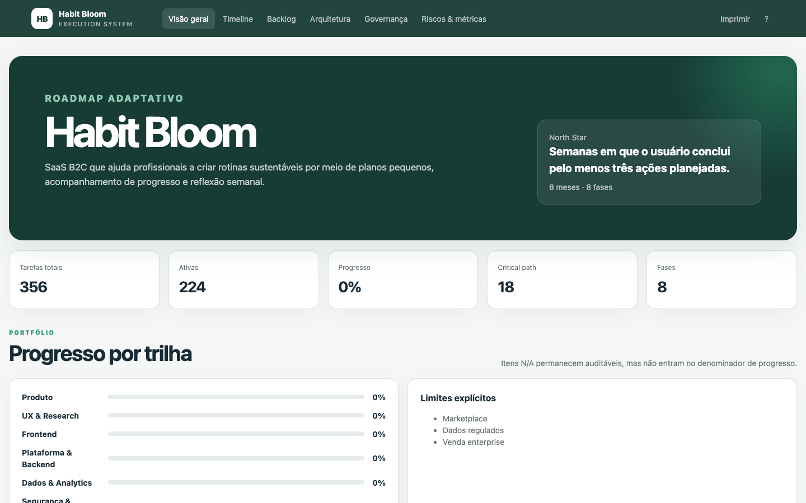
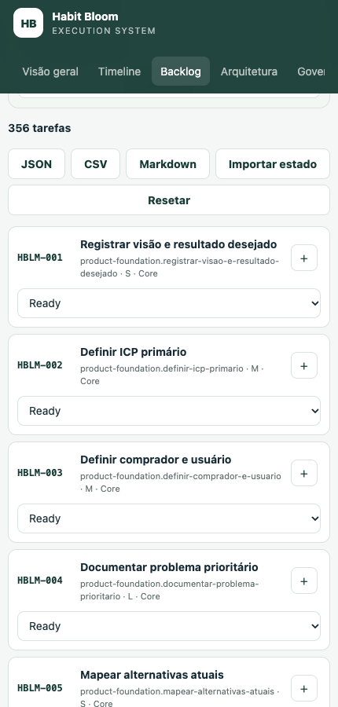
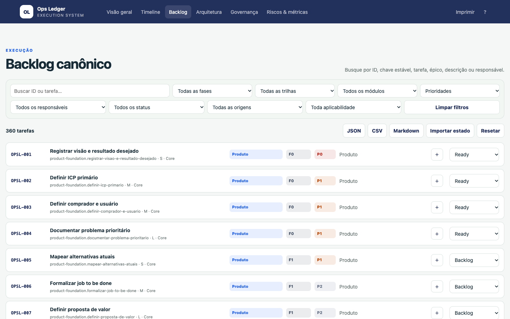
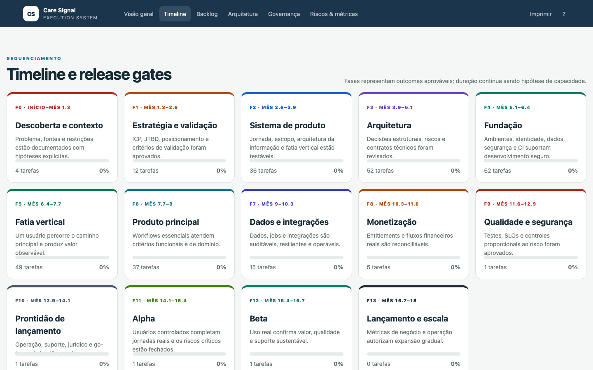
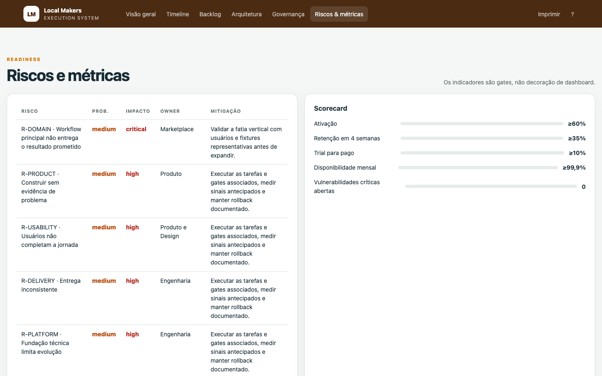
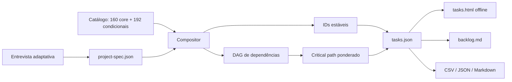

# Universal SaaS Roadmap Generator

> De uma entrevista com o fundador para um sistema de execução com 220–400 tarefas, dependências, critical path, gates, riscos, métricas e rastreabilidade — em um único HTML offline.




## O problema

Roadmaps de SaaS costumam falhar de duas formas: viram listas genéricas sem contexto ou planos rígidos que ignoram capacidade, dependências e riscos. Este projeto trata planejamento como um problema de modelagem e geração determinística.

O sistema entrevista o fundador, registra hipóteses e decisões, ativa módulos aplicáveis e gera um backlog navegável. O resultado não depende da memória da IA nem de um prompt isolado: catálogo, schemas, regras de identidade, grafo de dependências e validações são versionados.

## O que o projeto demonstra

| Capacidade | Implementação |
|---|---|
| Product discovery | Entrevista adaptativa em 13 blocos e matriz de escopo confirmável |
| Domain modeling | Contratos JSON para projeto, tarefas, riscos, métricas e RACI |
| Graph algorithms | Detecção de ciclos e longest weighted path para o critical path |
| Stable identity | IDs preservados entre regenerações por `catalogKey` |
| Secure rendering | Neutralização de XSS, validação de imports e nenhum script remoto |
| Offline-first UX | Busca, 9 filtros, status, impressão e `localStorage` namespaced |
| Developer experience | CLI sem dependências, fixtures, validação e CI reproduzível |
| Responsive design | A mesma experiência em desktop, mobile e impressão |

## Quatro produtos, o mesmo motor

### SaaS B2C — Habit Bloom

224 tarefas ativas em oito fases para um produto de formação de hábitos. Mostra adaptação de tema, escopo enxuto, métricas de ativação e exclusões explícitas.



### SaaS B2B multi-tenant — Ops Ledger

264 tarefas ativas com workspaces, RBAC, enterprise, API pública, migração e customer success. O backlog mantém chaves estáveis e rastreia itens não aplicáveis.



### IA com dados regulados — Care Signal

276 tarefas ativas, horizonte de 18 meses e gates próprios para IA, documentos, privacidade, validação e revisão humana.



### Marketplace — Local Makers

288 tarefas ativas cobrindo liquidez, reputação, pagamentos, UGC, mobile, comunidade e operação de dois lados.



Veja a análise completa em [casos de uso](docs/USE_CASES.md).

## Como funciona



1. A IA conduz a entrevista descrita em [`INTERVIEW_PLAYBOOK.md`](INTERVIEW_PLAYBOOK.md).
2. O fundador confirma a matriz `included`, `uncertain` e `not_applicable`.
3. O [`MASTER_PROMPT.md`](MASTER_PROMPT.md) produz um `project-spec.json` válido.
4. O gerador combina o spec com o catálogo universal.
5. O validador bloqueia ciclos, referências inválidas e gates incompletos.
6. O painel é gerado como um arquivo HTML autônomo.

## Quick start

Requer Node.js 20 ou superior. Não há dependências de runtime.

```bash
git clone https://github.com/leonardoolimpiousp-lang/saas-roadmap-generator.git
cd saas-roadmap-generator

npm test
npm run generate:examples
npm run validate:examples
```

Gerar um produto:

```bash
node scripts/generate-roadmap.mjs \
  --spec caminho/project-spec.json \
  --out caminho/roadmap

node validate-roadmap.mjs caminho/roadmap
```

Abra `caminho/roadmap/tasks.html` diretamente no navegador.

## Artefatos gerados

- `project-spec.json` — decisões, hipóteses, módulos, equipe e tema.
- `tasks.json` — fonte canônica de tarefas e grafo.
- `backlog.md` — revisão humana e criação de issues.
- `tasks.html` — painel offline, responsivo e imprimível.

Itens fora de escopo não desaparecem: permanecem como `not_applicable`, com justificativa. Isso permite revisar decisões sem recomeçar o planejamento.

## Catálogo e módulos

O catálogo possui 160 tarefas universais e 192 tarefas condicionais. Os módulos cobrem IA, subscriptions, marketplace, multi-tenancy, enterprise, processamento de documentos, realtime, APIs, mobile, dados regulados, internacionalização, UGC, migração, developer tools, comunidade e customer success.

Novas capacidades específicas entram como `domain-specific`; o catálogo universal não herda conteúdo de outros produtos.

## Operação e qualidade

- [Runbook operacional](docs/OPERATIONS.md)
- [Arquitetura e decisões técnicas](docs/ARCHITECTURE.md)
- [Estudo de caso para portfólio](docs/PORTFOLIO_CASE_STUDY.md)
- [Roteiro de demonstração em 5 minutos](docs/DEMO_SCRIPT.md)
- [Casos de uso](docs/USE_CASES.md)

```bash
npm test
npm run build:catalog
npm run generate:examples
npm run validate:examples
```

## Estrutura

```text
├── MASTER_PROMPT.md
├── INTERVIEW_PLAYBOOK.md
├── catalog/
├── schemas/
├── scripts/
├── template/
├── examples/
├── docs/
├── tests/
└── validate-roadmap.mjs
```

## Por que está no meu portfólio

Este projeto mostra meu trabalho na interseção entre produto e engenharia: transformar uma conversa ambígua em dados estruturados, regras verificáveis, algoritmos de planejamento e uma interface utilizável sem infraestrutura externa.

Eu tratei o roadmap como produto, não como documento. A implementação inclui descoberta, modelagem de domínio, geração determinística, segurança de conteúdo, UX responsiva, testes automatizados e operação reproduzível.

Detalhes sobre decisões, trade-offs e evolução estão no [case study](docs/PORTFOLIO_CASE_STUDY.md).

## Uso comercial

O kit pode apoiar founders, consultorias, product studios, fractional CTOs e equipes que precisam transformar discovery em execução auditável. Para discutir adaptação, implantação ou licenciamento, abra uma issue neste repositório.

## Direitos

Este repositório é público para demonstração e avaliação. Nenhuma licença open source é concedida enquanto não houver um arquivo de licença explícito.

