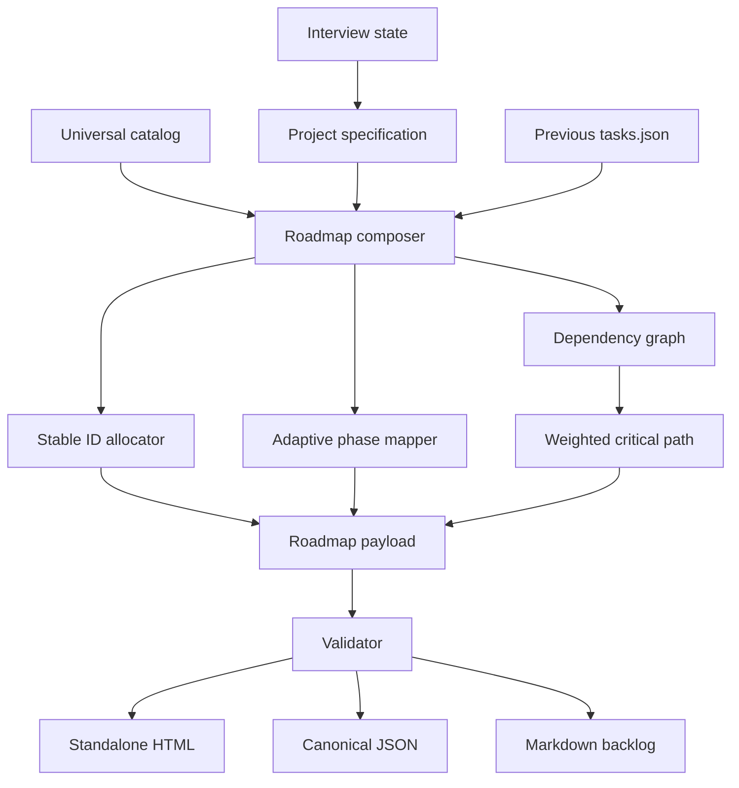

# Arquitetura

## Objetivo arquitetural

Manter decisões de produto, catálogo reutilizável e apresentação visual desacoplados. O mesmo shell pode representar SaaS diferentes sem copiar conteúdo de um projeto para outro.

## Camadas

### Entrevista

`MASTER_PROMPT.md` e `INTERVIEW_PLAYBOOK.md` definem o protocolo conversacional. A IA coleta dados; não decide silenciosamente módulos críticos.

### Contratos

Os schemas descrevem projeto, tarefas, riscos, métricas, RACI e exportação. Enums e IDs permanecem independentes do idioma da interface.

### Catálogo

`universal-backlog.json` contém:

- 160 tarefas core;
- 192 tarefas condicionais;
- 16 módulos ativáveis;
- dependências por `catalogKey`;
- critérios de aceite, risco, esforço e estágio padrão.

### Composição

O compositor:

1. deduplica por `catalogKey`;
2. preserva IDs de gerações anteriores;
3. aplica decisões de módulo;
4. converte dependências para IDs visíveis;
5. remove dependências ativas sobre tarefas N/A;
6. distribui tarefas em 6–14 fases;
7. calcula o critical path.

### Apresentação

O gerador injeta o payload validado em `tasks.template.html`. O arquivo final não carrega fontes, scripts, analytics ou APIs externas.

## Identidade estável

O ID humano (`ACME-042`) pode ser sequencial, mas sua identidade real é `catalogKey`. Quando existe um `tasks.json` anterior, o gerador recupera o ID correspondente e atribui novos números apenas a tarefas novas.

Isso permite:

- reorganizar fases sem renumerar issues;
- comparar duas gerações;
- atualizar o catálogo sem duplicar tarefas;
- preservar referências em ferramentas externas.

## Critical path

O grafo ativo é ordenado topologicamente. Cada esforço possui peso:

| Esforço | Peso |
|---|---:|
| XS | 1 |
| S | 2 |
| M | 3 |
| L | 5 |
| XL | 8 |

Para cada nó, o algoritmo mantém a maior distância acumulada entre suas dependências. O maior caminho resultante é marcado no payload. Um ciclo impede a geração.

## Segurança

- JSON embutido escapa `<`, `U+2028` e `U+2029`.
- Todo conteúdo dinâmico renderizado com `innerHTML` passa por escaping.
- Cores são validadas contra hexadecimal de seis dígitos.
- Imports exigem o mesmo `project.slug`.
- Tarefas N/A não podem ser dependência de tarefas ativas.
- O painel não recebe credenciais e não acessa a rede.
- O estado local usa namespace por slug e versão do schema.

## Trade-offs

- O catálogo é amplo e exige entrevista disciplinada para evitar excesso de escopo.
- A estimativa usa pesos relativos, não previsão probabilística de prazo.
- O HTML standalone prioriza portabilidade sobre colaboração em tempo real.
- JSON Schema documenta contratos; a validação operacional usa código nativo para manter zero dependências.

## Extensões possíveis

- sincronização opcional com GitHub Projects;
- visualização interativa do DAG;
- cálculo de capacidade por equipe;
- histórico semântico de alterações entre specs;
- catálogo multilíngue;
- plugin ou skill para execução automática da entrevista.

